<!-- guide:meta
feature: portal.notices
title: নোটিশ (অভিভাবক ও শিক্ষার্থী)
summary: স্কুলের দেওয়া নোটিশ পড়ুন, ফাইল খুলুন, আর জরুরি নোটিশে পড়েছি চাপুন।
roles: [PARENT, STUDENT]
sources:
  - client-admin/src/routes/portal/notices/index.tsx
  - client-admin/src/routes/portal/notices/$noticeId.tsx
  - client-admin/src/features/notices/read/my-notices-list.tsx
  - client-admin/src/features/notices/read/my-notice-detail.tsx
labels: [portalNotices:*, attention:notice.*, nav:items.portalNotices, nav:items.more]
helpIds: [portal.notices]
devices: [phone]
entry: [sidebar, palette, bell]
keywords: [নোটিশ, জরুরি নোটিশ, পড়েছি, পুরনো নোটিশ, notice, important notice, archive]
appVersion: 0.1.0 (19c3f195c)
owner: tareq89
lastVerified: 2026-11-02
knownIssues: []
-->

# নোটিশ (অভিভাবক ও শিক্ষার্থী)

স্কুলের দেওয়া নোটিশ পড়ুন আর ফাইল খুলুন।

**যেতে হবে:** ফোনে নিচের বারে **আরও** → **নোটিশ**। কম্পিউটারে বাম মেনুতে **নোটিশ**।
**শুরুর আগে:** স্কুলকে আপনার (বা সন্তানের) নোটিশ পাঠানো লাগবে। একাধিক সন্তান থাকলে নোটিশের ওপরে লেখা থাকে কার জন্য: **<নাম>-র জন্য**।

[নোটিশ পড়ুন](#task-main) · [জরুরি নোটিশে পড়েছি](#task-important) · [পুরনো নোটিশ](#task-archive) · [সমস্যা ও সমাধান](#trouble)

**এই পাতায় যা আছে**

- [এই পাতায় যেভাবে আসবেন](#arrive)
- [নোটিশ পড়ুন](#task-main)
- [পড়া হলো কি না বুঝবেন কীভাবে](#confirm)
- [অন্য পরিস্থিতিতে](#other)
  - [জরুরি নোটিশে পড়েছি](#task-important)
  - [পুরনো নোটিশ খোঁজা](#task-archive)
- [সমস্যা ও সমাধান](#trouble)
- [কে কী করতে পারেন](#roles)
- [আরও জানুন](#more)

---

## এই পাতায় যেভাবে আসবেন 

**ফোনে:** নিচের বারে **আরও** → **নোটিশ**।

**কম্পিউটারে:** বাম মেনুতে **নোটিশ**।

**প্রথম পাতা থেকে:** **সাম্প্রতিক নোটিশ** কার্ডে কোনো নোটিশ চাপুন, অথবা **সব নোটিশ** চাপুন।

**বিজ্ঞপ্তি থেকে:** জরুরি নোটিশ এলে ওপরের সতর্কতা বারে **নোটিশ খুলুন** চাপুন।

---

## নোটিশ পড়ুন 

1. **নোটিশ** খুলুন।

   → **চলতি** ট্যাবে চলতি নোটিশের তালিকা: **নোটিশ**, **অবস্থা**, **তারিখ**। যে নোটিশ আপনি এখনো খোলেননি তা গাঢ় অক্ষরে থাকে।

2. পড়তে চাওয়া নোটিশের নাম চাপুন।

   → নোটিশের লেখা আর (থাকলে) ফাইল দেখা যায়।

3. কোনো ফাইল দেখতে **<ফাইলের নাম> খুলুন** চাপুন।

   → ফাইলটি খোলে।

> **মনে রাখুন:** নোটিশ খুললেই স্কুল দেখতে পায় যে আপনি দেখেছেন। জরুরি নোটিশে এর পরে আরও একটি কাজ আছে: **পড়েছি**।

---

## পড়া হলো কি না বুঝবেন কীভাবে 

তালিকায় ফিরে যান। নোটিশটি আর গাঢ় অক্ষরে নেই। জরুরি নোটিশে **পড়েছি** চাপা হলে নোটিশের পাতায় বোতামটি আর থাকে না, আর ওপরের সতর্কতা বার চলে যায়।

| অবস্থা                  | কীভাবে বুঝবেন                                |
| ----------------------- | -------------------------------------------- |
| **না খোলা**             | তালিকায় গাঢ় অক্ষর                          |
| **খোলা**                | তালিকায় সাধারণ অক্ষর                        |
| **পড়েছি (শুধু জরুরি)** | নোটিশে **পড়েছি** বোতাম নেই, সতর্কতা বার নেই |

---

## অন্য পরিস্থিতিতে 

### জরুরি নোটিশে পড়েছি 

জরুরি নোটিশের পাশে **জরুরি** চিহ্ন থাকে। স্কুল চায় আপনি যে পড়েছেন তা জানান। না জানানো পর্যন্ত ওপরে একটি সতর্কতা বার থাকে।

1. জরুরি নোটিশ খুলুন, লেখা পড়ুন।
2. নিচে **পড়েছি** চাপুন।

   → বোতাম আর বার চলে যায়, আর স্কুল দেখতে পায় আপনি পড়েছেন।

সতর্কতা বার থেকেও **পড়েছি** চাপা যায়। যে নোটিশ বদলানো হয়েছে, তার পাশে **সম্পাদিত** চিহ্ন থাকে।

### পুরনো নোটিশ খোঁজা 

1. **পুরনো** ট্যাব চাপুন। → আগের নোটিশগুলো আসে।
2. খুঁজতে **শিরোনাম দিয়ে খুঁজুন** ঘরে নাম লিখুন, অথবা **সাল** থেকে একটি সাল বাছুন।

কোনো নোটিশ না থাকলে **চলতি কোনো নোটিশ নেই** বা **পুরনো কোনো নোটিশ নেই** আসে।

---

## সমস্যা ও সমাধান 

| আপনি যা দেখছেন                | কী করবেন                                                   | কে সাহায্য করতে পারেন |
| ----------------------------- | ---------------------------------------------------------- | --------------------- |
| **চলতি কোনো নোটিশ নেই**       | আপনার জন্য কোনো নোটিশ দেওয়া হয়নি। স্কুল দিলে এখানে আসবে। | স্কুল অফিস            |
| **নোটিশ আনা যায়নি।**         | ইন্টারনেট দেখে **আবার চেষ্টা করুন** চাপুন।                 | —                     |
| নোটিশ খুলছে না                | স্কুল হয়তো নোটিশটি ফিরিয়ে নিয়েছে।                       | স্কুল অফিস            |
| SMS-এ লিংক পেয়েছেন, খুলছে না | লিংকটি বন্ধ হয়েছে। স্কুলের কাছে নতুন লিংক চান।            | স্কুল অফিস            |

---

## কে কী করতে পারেন 

| ভূমিকা     | নোটিশ পড়া | **পড়েছি** চাপা |
| ---------- | ---------- | --------------- |
| অভিভাবক    | হ্যাঁ      | হ্যাঁ           |
| শিক্ষার্থী | হ্যাঁ      | হ্যাঁ           |

নোটিশ দেওয়ার কাজ স্কুলের কর্মীদের: [নোটিশ দিন ও দেখুন](../communications/notices.md)।

---

## আরও জানুন 

<strong>নোটিশ কীভাবে কাজ করে</strong>

<figure>
  
  <figcaption><em>নোটিশ যেভাবে পড়বেন</em></figcaption>
</figure>

- **গাঢ় অক্ষর:** নোটিশটি এখনো খোলা হয়নি।
- **জরুরি:** **পড়েছি** চাপা পর্যন্ত সতর্কতা বার থাকে।
- **পুরনো:** আগের নোটিশ এখানে থাকে।

**সম্পর্কিত পাতা**

- [**নোটিশ দিন ও দেখুন**](../communications/notices.md) — কর্মীরা নোটিশ যেখান থেকে দেন।

---

_সংস্করণ ০.১.০ · শেষ যাচাই ২০২৬-১১-০২_
