<!-- guide:meta
feature: portal.notices
title: Notices (parent and student)
summary: Read the notices your school gave, open their files, and press I have read this on an important notice.
roles: [PARENT, STUDENT]
sources:
  - client-admin/src/routes/portal/notices/index.tsx
  - client-admin/src/routes/portal/notices/$noticeId.tsx
  - client-admin/src/features/notices/read/my-notices-list.tsx
  - client-admin/src/features/notices/read/my-notice-detail.tsx
labels: [portalNotices:*, attention:notice.*, nav:items.portalNotices, nav:items.more]
helpIds: [portal.notices]
devices: [phone]
entry: [sidebar, palette, bell]
keywords: [নোটিশ, জরুরি নোটিশ, পড়েছি, পুরনো নোটিশ, notice, important notice, archive]
appVersion: 0.1.0 (19c3f195c)
owner: tareq89
lastVerified: 2026-11-02
knownIssues: []
-->

# Notices (parent and student)

Read the notices your school gave, and open their files.

**Where to go:** on a phone, the bottom bar's **More** → **Notices**. On a computer, **Notices** in the left menu.
**Before you start:** the school must have sent you (or your child) a notice. With more than one child, each notice says whom it is for: **For <name>**.

[Read a notice](#task-main) · [I have read this on an important notice](#task-important) · [Old notices](#task-archive) · [Problems and fixes](#trouble)

**On this page**

- [How to get to this page](#arrive)
- [Read a notice](#task-main)
- [How to know it was read](#confirm)
- [Other situations](#other)
  - [I have read this on an important notice](#task-important)
  - [Finding old notices](#task-archive)
- [Problems and fixes](#trouble)
- [Who can do what](#roles)
- [Learn more](#more)

---

## How to get to this page 

**On a phone:** the bottom bar's **More** → **Notices**.

**On a computer:** **Notices** in the left menu.

**From the first page:** on the **Latest notices** card tap a notice, or tap **All notices**.

**From a notification:** when an important notice comes, in the bar at the top tap **Open notice**.

---

## Read a notice 

1. Open **Notices**.

   → The **Current** tab shows the list of current notices: **Notice**, **Status**, **Date**. A notice you have not opened yet is in bold.

2. Tap the name of the notice you want to read.

   → The notice text shows, and its files if it has any.

3. To see a file, tap **Open <file name>**.

   → The file opens.

> **Remember:** the moment you open a notice, the school can see that you have seen it. On an important notice there is one more step: **I have read this**.

---

## How to know it was read 

Go back to the list. The notice is no longer in bold. On an important notice, once **I have read this** is pressed the button is gone from the notice and the warning bar at the top goes away.

| State                                 | How you can tell                               |
| ------------------------------------- | ---------------------------------------------- |
| **Not opened**                        | Bold in the list                               |
| **Opened**                            | Normal letters in the list                     |
| **I have read this (important only)** | No **I have read this** button, no warning bar |

---

## Other situations 

### I have read this on an important notice 

An important notice has the **Important** mark beside it. The school wants you to tell it you have read the notice. Until you do, a warning bar stays at the top.

1. Open the important notice and read the text.
2. At the bottom press **I have read this**.

   → The button and the bar go, and the school can see you have read it.

You can also press **Mark as read** from the warning bar. A notice that was changed shows an **Edited** mark.

### Finding old notices 

1. Tap the **Archive** tab. → Earlier notices show.
2. To find one, type in **Search by title**, or pick a year from **Year**.

If there is nothing, you see **No current notices** or **No old notices**.

---

## Problems and fixes 

| What you see                               | What to do                                                            | Who can help  |
| ------------------------------------------ | --------------------------------------------------------------------- | ------------- |
| **No current notices**                     | No notice was given to you. When the school gives one, it shows here. | School office |
| **Could not load notices.**                | Check your internet and press **Try again**.                          | —             |
| A notice does not open                     | The school may have taken it back.                                    | School office |
| You got a link by SMS and it does not open | The link has been turned off. Ask the school for a new link.          | School office |

---

## Who can do what 

| Role    | Read notices | Press **I have read this** |
| ------- | ------------ | -------------------------- |
| Parent  | Yes          | Yes                        |
| Student | Yes          | Yes                        |

Giving notices is for the school's staff: [Give and follow notices](../communications/notices.md).

---

## Learn more 

<strong>How notices work</strong>

<figure>
  
  <figcaption><em>How you read a notice</em></figcaption>
</figure>

- **Bold:** the notice has not been opened yet.
- **Important:** a warning bar stays until you press **I have read this**.
- **Archive:** earlier notices are kept here.

**Related pages**

- [**Give and follow notices**](../communications/notices.md) — where staff give notices.

---

_Version 0.1.0 · Last verified 2026-11-02_
