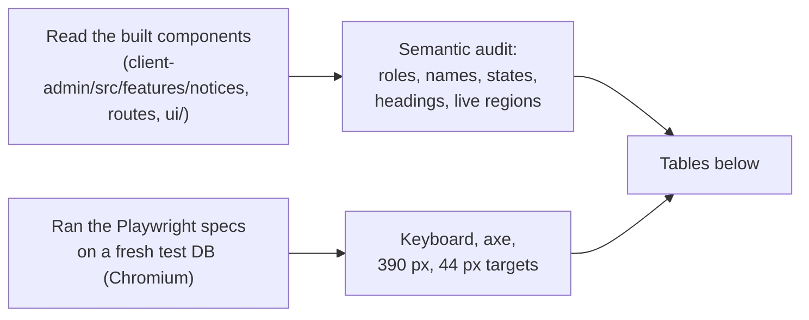

# Epic 53 notice board: usability tasks and status

**Status (2026-11-05):**

| Check                                 | Done?  | Who                            | What it proves                                                                                           |
| ------------------------------------- | ------ | ------------------------------ | -------------------------------------------------------------------------------------------------------- |
| Usability test with real people (ক–ঙ) | **No** | needs office staff + guardians | whether a person finds the path unaided, in time                                                         |
| Screen-reader run (VoiceOver / NVDA)  | **No** | needs a person with a reader   | what a reader really says and how it feels to use                                                        |
| Expert audit (this page, below)       | Yes    | AI reviewer, not real users    | that the path exists, works by keyboard, and the markup gives a reader the right roles, names and states |

The expert audit is **not** a user test. It cannot say whether a person finds the way, or how long it
takes. Nothing in it moves a "passes unaided" acceptance line.

Why no user test: the usability test (#3367) needs real office staff and real guardians. It was
skipped by decision D1, so there are no mockup results either. Step 5 of #3382 ("re-run tasks ক, গ,
ঙ on the built screens with one staff member and one guardian") and the final check in #3390 cannot
be done by an agent. Those acceptance lines stay **open** until a person runs them.

## The tasks (from the epic)

| #   | Who                   | Task                                                 | Target        | Where it starts                                    |
| --- | --------------------- | ---------------------------------------------------- | ------------- | -------------------------------------------------- |
| ক   | Office staff or admin | Post a PDF notice to the guardians of Class 9 and 10 | 3 min or less | Communications › নোটিশ › নতুন নোটিশ                |
| খ   | Office staff          | Mark a notice important and ask for an SMS           | 3 min or less | Communications › নোটিশ › নতুন নোটিশ                |
| গ   | Office staff or admin | See who has not read a notice                        | 1 min or less | Communications › নোটিশ › open a notice › কে পড়েছে |
| ঘ   | Admin                 | Turn off a public link                               | 1 min or less | Communications › নোটিশ › open a notice             |
| ঙ   | Guardian              | Open the latest notice                               | 1 min or less | Portal Overview, or Portal › নোটিশ                 |

"Unaided" means the person gets there without anyone telling them where to click.

## How to run the human test

1. Use the demo school. Sign in as the `admin` card for ক, খ, গ, ঘ, and as a guardian card for ঙ.
2. Read the task aloud in the person's own words. Say nothing else. Do not point.
3. Time it. Write down where they stopped, hesitated or went the wrong way.
4. Fill in the table below. A task passes only if it is unaided and inside its target.

## Human results

| #   | Participant | Time | Unaided? | Where they hesitated | Change made |
| --- | ----------- | ---- | -------- | -------------------- | ----------- |
| ক   | not run     |      |          |                      |             |
| খ   | not run     |      |          |                      |             |
| গ   | not run     |      |          |                      |             |
| ঘ   | not run     |      |          |                      |             |
| ঙ   | not run     |      |          |                      |             |

Screen-reader run: cover, in this order, compose (3 steps), notice detail (link panel, SMS part),
SMS approval page, "who has read it" report, portal list and detail, public page `/n/<token>`. On
each, check: the page has one `h1`; every button and checkbox says what it does when read alone
(for example "Send an SMS to <name>"); the dead-link message is read when the page loads; a toast
("Link copied.") is announced; focus lands inside a dialog and returns on close.

| Screen                 | Reader + browser | Result | Notes |
| ---------------------- | ---------------- | ------ | ----- |
| compose                | not run          |        |       |
| detail                 | not run          |        |       |
| SMS approval           | not run          |        |       |
| report                 | not run          |        |       |
| portal list and detail | not run          |        |       |
| public page            | not run          |        |       |

## Expert audit (2026-11-05, by AI reviewer, not real users)

How it was done:

- **Semantic audit, not run with VoiceOver/NVDA.** "Reader hears" below is what the markup gives a
  screen reader. A real reader can still say it differently.
- Results: **pass** = evidence below shows it works; **fail** = a real defect; **needs-human** = only
  a person can tell.
- Tests run (all green, 2026-11-05, `main` at `725997b71`):
  - `e2e/journeys/notices.spec.ts`, `e2e/journeys/notice-links-sms.spec.ts`
  - `e2e/a11y/notices.a11y.spec.ts` (bn + en), the notice routes in `routes.a11y.spec.ts`
    (bn, en, bn dark), `reflow.spec.ts` (320 / 640 px) and `target-size.spec.ts` (24 px; 44 px at
    360 px)
  - `e2e/keyboard/nav-communications.spec.ts`
  - **new:** `e2e/a11y/notices-sms-public.a11y.spec.ts`, for the screens the old a11y spec did not
    reach: the SMS page, the report tab, an open confirm, and the public page (live and dead), at
    390 px too
  - vitest: `client-admin/src/features/notices/**`, `routes/n.$token.test.tsx`,
    `routes/notices-routes.test.tsx`, `ui/src/components/confirm-dialog.test.tsx`,
    `ui/src/components/audience-builder/**`
- Colour contrast is checked by axe in a real browser (light and dark). jsdom cannot check it.

### Task ক: post a PDF notice to the guardians of two classes

| Step | What the user does                                           | Result      | Evidence                                                                                                                                                |
| ---- | ------------------------------------------------------------ | ----------- | ------------------------------------------------------------------------------------------------------------------------------------------------------- |
| 1    | Communications › নোটিশ › "নোটিশ দিন" (link)                  | pass        | `nav-communications.spec.ts` › notices: reached by keyboard, Escape closes the composer                                                                 |
| 2    | Title and text; each field has a label; an error is read out | pass        | `notice-compose.tsx:365,385` (`role="alert"` error under the field); axe clean on compose                                                               |
| 3    | Attach the PDF                                               | pass        | `notices.spec.ts` step 1 attaches a PDF                                                                                                                 |
| 4    | Pick "guardians" and two classes                             | pass        | `AudienceBuilder` tabs are Radix tabs (`audience-builder.tsx:207`); the chosen count is `aria-live="polite"` (`chosen-list.tsx:37`)                     |
| 5    | Steps show where you are                                     | pass        | `aria-current="step"` (`notice-compose.tsx:334`)                                                                                                        |
| 6    | Publish › confirm dialog                                     | pass        | `publish-confirm-dialog.tsx`: title + description, Cancel then Publish; an error inside uses `role="alert"`                                             |
| 7    | Public-link dialog after publish                             | **fixed**   | It had an X button that did nothing (the dialog ignores close until Done). Removed; test `the public-link dialog has no Close button that does nothing` |
| 8    | Whole task by keyboard only                                  | pass (code) | Every control is a native button / input or a Radix widget. No spec types the whole task by keyboard; this is read from the code                        |
| 9    | Time and "unaided"                                           | needs-human |                                                                                                                                                         |

### Task খ: mark important and ask for an SMS; the admin approves

| Step | What the user does                                   | Result                | Evidence                                                                                                                                                                                         |
| ---- | ---------------------------------------------------- | --------------------- | ------------------------------------------------------------------------------------------------------------------------------------------------------------------------------------------------ |
| 1    | Tick "important" and "ask for SMS" in compose        | pass                  | Checkboxes with visible labels; axe clean                                                                                                                                                        |
| 2    | Confirm says nothing is sent until an admin approves | pass                  | `publish-confirm-dialog.tsx` shows `confirm.sms`                                                                                                                                                 |
| 3    | Admin opens the SMS page from the notice             | pass                  | `notice-link-panel.tsx:172` "SMS দেখুন"; `notice-links-sms.spec.ts`                                                                                                                              |
| 4    | SMS page: counts, text, cost, list                   | pass                  | `notice-sms-page.tsx`: `<dl>` counts, `<h2>` for the text, table with a caption. New spec: axe clean, no sideways scroll at 390 px, every target ≥ 44 px                                         |
| 5    | Untick one guardian                                  | pass, 1 defect        | Each box has a name: "Send an SMS to <name>" (`notice-sms-page.tsx:168`). **Defect #3486:** a guardian with two children gets two boxes with the same name                                       |
| 6    | Approve                                              | pass                  | Footer primary in `FullPageShell`; disabled while a tick is saving (`notice-sms-page.tsx:250`). No extra confirm: the page itself is the preview with the cost                                   |
| 7    | Decline › confirm                                    | pass, 1 visual defect | `role="alertdialog"`, named by its title, focus inside, Escape closes (new spec). Escape is blocked while busy (`confirm-dialog.tsx:64`). **Defect #3487:** the confirm button shows a trash can |
| 8    | Error or result is announced                         | pass                  | Toasts come from sonner's own `aria-live` region (`ui/src/components/toast.tsx`); load errors are `role="alert"` (`notice-sms-page.tsx:179,181`)                                                 |
| 9    | Time and "unaided"                                   | needs-human           |                                                                                                                                                                                                  |

### Task গ: see who has not read a notice

| Step | What the user does              | Result      | Evidence                                                                     |
| ---- | ------------------------------- | ----------- | ---------------------------------------------------------------------------- |
| 1    | Open a notice › tab "কে পড়েছে" | pass        | `DetailShell` tabs, tab in the URL (`?tab=report`); `notices.spec.ts` step 4 |
| 2    | Read the five counts            | pass        | `<dl>` of `<dt>` + `<dd>` with a name (`notice-report-tab.tsx:70`)           |
| 3    | Filter to "not seen"            | pass        | Visible `<label for>` on the select (`notice-report-tab.tsx:79`)             |
| 4    | Read the table                  | pass        | `DataTable` with a caption; axe clean (new spec)                             |
| 5    | Time and "unaided"              | needs-human |                                                                              |

### Task ঘ: turn off a public link

| Step | What the user does                        | Result           | Evidence                                                                                                                                                                                                                                                                                              |
| ---- | ----------------------------------------- | ---------------- | ----------------------------------------------------------------------------------------------------------------------------------------------------------------------------------------------------------------------------------------------------------------------------------------------------- |
| 1    | Find the "Public link" part of the notice | pass             | `<h2>` "Public link" (`notice-link-panel.tsx:76`)                                                                                                                                                                                                                                                     |
| 2    | "Turn off link" › confirm                 | pass             | `role="alertdialog"`; `notice-links-sms.spec.ts` case 1                                                                                                                                                                                                                                               |
| 3    | "The public link is off." is announced    | pass             | toast (sonner live region)                                                                                                                                                                                                                                                                            |
| 4    | Focus after the dialog closes             | **fail (known)** | Focus goes to the page, not back to the button. Known for every dialog opened from a plain button: 21-ui-patterns §14 "Focus does not return", `FOCUS_RETURN_KNOWN_BROKEN = true` in `e2e/keyboard/keyboard-utils.ts`. After a turn-off the button is gone anyway, so focus has nowhere to go back to |
| 5    | Copy a new link: "Link copied." announced | pass             | `notice-link-panel.tsx:58`; the link field has a name (`:80`)                                                                                                                                                                                                                                         |
| 6    | Time and "unaided"                        | needs-human      |                                                                                                                                                                                                                                                                                                       |

### Task ঙ: a guardian opens the latest notice

| Step | What the user does                              | Result          | Evidence                                                                                                                              |
| ---- | ----------------------------------------------- | --------------- | ------------------------------------------------------------------------------------------------------------------------------------- |
| 1    | See it on the Overview card                     | pass            | `WidgetCard` region named "সাম্প্রতিক নোটিশ"; `notices.spec.ts` step 2                                                                |
| 2    | Open it                                         | pass, slow path | Rows on the card are not links: the guardian goes Overview › "All notices" › title (3 clicks). Open: #3437                            |
| 3    | The notice list                                 | pass            | Each title is a button (`my-notices-list.tsx:63`); unread is bold only, but the reader still gets the title. axe clean (bn, en, dark) |
| 4    | The notice opens in a dialog                    | pass            | The dialog has an sr-only title and description (`my-notices-list.tsx:175`); the notice title is its `h2`                             |
| 5    | Opened as its own page (`/portal/notices/<id>`) | fail (known)    | The page `h1` is "Notices", not the notice title. Open: #3438                                                                         |
| 6    | "পড়েছি" on an important notice                 | pass            | A real button, 44 px (`my-notice-detail.tsx:110`)                                                                                     |
| 7    | The warning bar                                 | fail (known)    | The bar's popup still lets an important notice be closed without "পড়েছি". Open: #3439                                                |
| 8    | Time and "unaided"                              | needs-human     |                                                                                                                                       |

### Public page `/n/<token>`

| Check                                       | Result      | Evidence                                                                                                                                                                                                                     |
| ------------------------------------------- | ----------- | ---------------------------------------------------------------------------------------------------------------------------------------------------------------------------------------------------------------------------- |
| One `h1`, the notice title                  | pass        | `n.$token.tsx:123`; new spec checks exactly one `h1`                                                                                                                                                                         |
| Body shown as text, never HTML              | pass        | plain `{n.body}` in a `
` (`n.$token.tsx:129`)                                                                                                                                                                             |
| Dead link: one fixed message for every case | pass        | 404 and 410 both go to the same `DeadLink` (`n.$token.tsx:37`)                                                                                                                                                               |
| Dead page never shows the token             | pass        | `notice-links-sms.spec.ts` case 1 and the new spec: `page.content()` has no token                                                                                                                                            |
| Token in the DOM on a live page             | pass        | Only in the address bar and in the file download links (`n.$token.tsx:140`), which need it                                                                                                                                   |
| Dead-link message read when the page loads  | needs-human | It is in a `role="status"` region (`-guest-status.tsx:34`) that already has its text on first paint. Some readers do not speak a live region that is full on load; the `h1` is still read first. Only a real reader can tell |
| 390 px, 44 px targets, axe (live and dead)  | pass        | new spec                                                                                                                                                                                                                     |

### Checks across all tasks

| Check                         | Result                      | Evidence                                                                                                                                                                              |
| ----------------------------- | --------------------------- | ------------------------------------------------------------------------------------------------------------------------------------------------------------------------------------- |
| Keyboard only                 | pass (code) / partly tested | The composer opens and closes by keyboard (`nav-communications.spec.ts`); the Decline dialog by keyboard (new spec). Other steps are read from the code: all native or Radix controls |
| Visible focus                 | pass                        | Shared ring on button, checkbox, tabs (`ui/src/primitives/*`: `focus-visible:ring-2`)                                                                                                 |
| Names for every control       | pass, 1 defect              | axe clean on all notice screens; #3486 for same-name tick boxes                                                                                                                       |
| Confirm dialogs               | pass                        | `ConfirmDialog` is `role="alertdialog"`, focus trapped, Escape closes unless busy, outside click ignored (`confirm-dialog.tsx:61-66`)                                                 |
| Focus returns after a dialog  | fail (known)                | 21-ui-patterns §14                                                                                                                                                                    |
| Live regions                  | pass                        | sonner toasts; `role="alert"` errors; `aria-live` chosen count; `role="status"` loading                                                                                               |
| Colour contrast (light, dark) | pass                        | axe in Chromium on every notice route, bn dark included. Only tokens are used (`text-text-secondary`, `bg-status-*`), no raw colours                                                  |
| 390 px phone                  | pass                        | no sideways scroll at 320 / 640 px on all notice routes; 390 px on the SMS and public pages (new spec); 44 px targets at 360 px                                                       |
| bn/en parity                  | pass                        | `notices`, `noticeCompose`, `portalNotices`: same keys and the same `{{placeholders}}` in both (129 / 105 / 25 keys)                                                                  |

### Defects

| #     | Defect                                                                      | Where                                    | What happened                            |
| ----- | --------------------------------------------------------------------------- | ---------------------------------------- | ---------------------------------------- |
| D1    | The public-link dialog after publish had an X that did nothing              | `notice-compose.tsx` (link dialog)       | **Fixed** in this PR, failing test first |
| D2    | Two tick boxes with the same name for a guardian with two children          | `notice-sms-page.tsx:168`                | Filed #3486                              |
| D3    | Trash-can icon on "New link" and "Decline" (shared `ConfirmDialog` default) | `confirm-dialog.tsx:48,93`               | Filed #3487                              |
| known | Focus does not return after a dialog closes                                 | 21-ui-patterns §14                       | already known                            |
| known | Overview card rows are not links; full page reload                          | `latest-notices-card.tsx:39`             | #3437                                    |
| known | Portal notice page `h1` is "Notices"                                        | `routes/portal/notices/$noticeId.tsx:22` | #3438                                    |
| known | Warning bar lets an important notice be closed                              | attention modal                          | #3439                                    |
| known | Staff with only `NOTICE_READ` cannot open an important notice               | `route-permissions.ts`                   | #3448                                    |

### Design-system check (instead of the missing 53.1.03 mockups)

The 53.1.03 mockups were never made (#3367, D1), and the project dropped the mockup gate: a screen
has to match the existing app. So each "matches the mockups" line was checked against
[21-ui-patterns](../architecture/21-ui-patterns.md) and the `@biddaloy/ui` kit instead.

| Issue | Screen                                                    | Consistent?      | Deviations                                                                                                                                                                                                                                    |
| ----- | --------------------------------------------------------- | ---------------- | --------------------------------------------------------------------------------------------------------------------------------------------------------------------------------------------------------------------------------------------- |
| #3375 | `AudienceBuilder` (`ui/src/components/audience-builder/`) | yes              | none found; has a story                                                                                                                                                                                                                       |
| #3376 | staff list, detail, report                                | yes              | `ListShell` / `DetailShell` / `DataTable`; tab in URL. No story for the detail or report tab (only `notice-list.stories.tsx`)                                                                                                                 |
| #3377 | compose                                                   | yes              | `FullPageShell` with steps; one primary per step. D1 above (fixed)                                                                                                                                                                            |
| #3378 | portal list, detail, Overview card, staff widget          | mostly           | The portal "important" and "edited" tags are hand-made `span`s, not `StatusBadge` (`my-notices-list.tsx:85-90`; §5 "status is always a `StatusBadge`"). Card rows are not links (#3437). Detail `h1` (#3438). No story for the list or detail |
| #3384 | advanced filter tabs                                      | yes              | `Combobox` and `Input` with labels, no native pickers. Missing stories and empty-state text: #3442                                                                                                                                            |
| #3385 | warning bar item                                          | yes for the item | `attention-notice-item.tsx` uses `RowActions` and a named "পড়েছি" button (44 px on phone). The bar popup does not use it: #3439                                                                                                              |
| #3387 | link panel, SMS page, public page                         | yes              | `Card` + `h2` panels, `FullPageShell` for the SMS page, `AuthLayout` + `GuestStatus` for the public page. D2, D3 above. No stories for these three                                                                                            |

Density: notice screens use the shared controls, which take their height from `--control-h` (32 px
staff desktop, 44 px phone and portal). The only fixed heights are `min-h-11` (44 px) on portal
buttons, which matches the portal rule.

Two code comments are out of date: `latest-notices-card.tsx` and
`server/src/modules/attention/api/attention-query.service.ts` still say the notice routes "arrive with
#3381"; #3381 is closed and the routes exist.

## What this audit cannot replace

- **A person finding the way.** The tasks have time targets and "unaided". Only people can show that.
- **A real screen reader.** The markup is right, but only VoiceOver or NVDA can show what is said, in
  which order, and whether Bangla is read well.
- **Real phones.** The 390 px checks ran in desktop Chromium at phone size, not on a cheap Android
  phone with a slow network.
- **Low literacy and first-time users.** Many guardians will meet the portal for the first time
  through a notice. Nothing here tests that.
