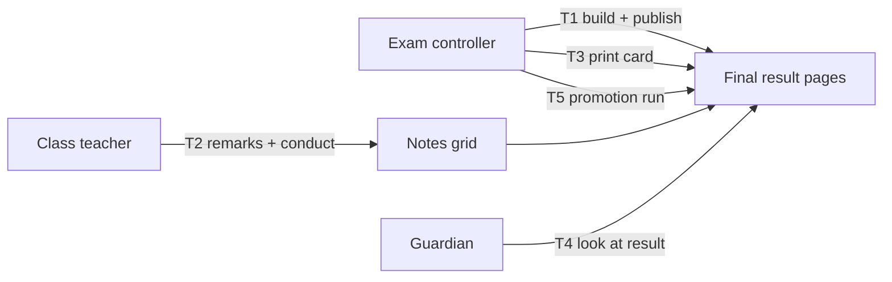
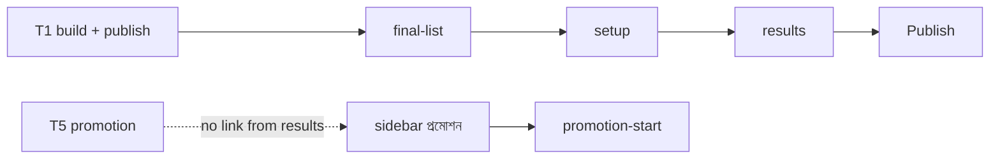

# Epic 70 usability test — final result

Epic 70 (#2203), ticket 70.0.01 (#3400). Words in [`epic-70-glossary.md`](epic-70-glossary.md). Mockups in [`epic-70-mockups/`](epic-70-mockups/): `.html`, `-1440.png`, `-390.png`.

Run kit: [`epic-70-observer-sheet.md`](epic-70-observer-sheet.md) (facilitator prints this) and [`epic-70-participant-brief.md`](epic-70-participant-brief.md) (participant reads this).

**Status: pending human run.** Nothing below was tested. No result is filled in or guessed. Steps 4-5 of #3400 need three real people.

Known limit: mockups are still pictures, so "press" means the tester points and says what they would press. The facilitator shows the next picture.

## Participants

| #   | Who             | Must be true                      | Tasks      | Name / date |
| --- | --------------- | --------------------------------- | ---------- | ----------- |
| P1  | Exam controller | runs exams in a real school       | T1, T3, T5 | _blank_     |
| P2  | Class teacher   | has a class teacher section       | T2         | _blank_     |
| P3  | Guardian        | has a child in school, uses phone | T4         | _blank_     |

First names only in this file. No phone numbers, no photos, no real child names (the repo is public).

## Tasks and targets

Target for every task: done **unaided** (no hint from the facilitator) in **3 minutes or less**. Mockups stay fixed until all five pass.

| Task | Say this (bn, as read to tester)                                                  | Success =                                                            | Mockup(s)                                                  |
| ---- | --------------------------------------------------------------------------------- | -------------------------------------------------------------------- | ---------------------------------------------------------- |
| T1   | "ক্লাস ৮-এর চূড়ান্ত ফলাফল বানান: অর্ধবার্ষিক ৩০, বার্ষিক ৭০। তারপর প্রকাশ করুন।" | Picks both exams, types 30 and 70, builds, then publishes.           | `final-list`, `final-detail-setup`, `final-detail-results` |
| T2   | "৮-ক-র ছাত্রদের মন্তব্য আর আচরণ দিন।"                                             | Writes a remark and picks a conduct grade for a student, then saves. | `my-class-notes`                                           |
| T3   | "একজন ছাত্রের রিপোর্ট কার্ড ছাপুন।"                                               | Reaches the print tab and prints one student's card.                 | `final-report-card`                                        |
| T4   | "অভিভাবক হিসেবে সন্তানের ফল দেখুন।"                                               | Finds the চূড়ান্ত ফলাফল card first and reads the result aloud.      | `portal-final-result`                                      |
| T5   | "চূড়ান্ত ফল থেকে প্রমোশন রান শুরু করুন।"                                         | Finds the promotion start from the final result.                     | `promotion-start` (added, see note below)                  |

Settings mockup `settings-conduct-items` is not a task screen on its own. Show it only if a tester asks where conduct items come from.

**T5 mockup added:** `promotion-start` draws the real "নতুন প্রমোশন তালিকা" page with the final result picked as the ranking source. It does **not** draw how a person gets there from the final result page, because the app has no button for it (only path: sidebar প্রমোশন, then "নতুন প্রমোশন তালিকা"). So T5 tests "find the way" as well as the form. Not tested on a person yet.

## Script (per task)

1. Say: this is a school app; the picture is page X. Say it once.
2. Read the task. Say nothing else. Start the timer when you stop talking.
3. Ask them to think aloud. Do not hint. If silent for 20 seconds, ask only: "What are you looking for?"
4. Stop at "done" with the right control, or at 3:00 (that is a **fail**).
5. Ask: "In your own words, what does that button do?" and "What happens next?"
6. Record time, unaided yes/no, where they hesitated, words they used.
7. Fix rule: more than 10 seconds on one control, or a word not in the glossary, counts as a finding even if the task passed.

## Results (fill in on the human run)

| Task | Person | Time (m:ss) | Unaided? (y/n) | Where they hesitated | Words used | Pass (3:00 or less, unaided) |
| ---- | ------ | ----------- | -------------- | -------------------- | ---------- | ---------------------------- |
| T1   | P1     |             |                |                      |            |                              |
| T2   | P2     |             |                |                      |            |                              |
| T3   | P1     |             |                |                      |            |                              |
| T4   | P3     |             |                |                      |            |                              |
| T5   | P1     |             |                |                      |            |                              |

## What changed after the test

| Round | Screen | What was unclear | Change | Re-test result |
| ----- | ------ | ---------------- | ------ | -------------- |
|       |        |                  |        |                |

Repeat rounds until every row above passes. Then re-shoot (`node .claude/skills/redesign-page/scripts/shoot.mjs`), re-upload with `upload.sh e70-<slug>`, and update the image links in the W5 tickets.

## Expert walkthrough (not participant test)

> **Review by AI (Claude), done at a desk.** This is NOT user evidence. No person tried these screens. It does not fill, replace or predict the results table above. It only gives the human run a head start: places to watch, and fixes worth making before or after the run.

Method: cognitive walkthrough. Per step ask: what does the user see, what must they work out, what could confuse them. Words checked against [`epic-70-glossary.md`](epic-70-glossary.md).

### T1 - build and publish (P1, exam controller)

| Step | Sees | Must work out | Likely confusion | Words vs glossary | Missing state |
| --- | --- | --- | --- | --- | --- |
| 1. Find the class | List; row "অষ্টম শ্রেণি" status "তৈরি"; button "খুলুন" | Row 6 has "শুরু করুন", row 8 has "খুলুন" | Which button starts a new build? Two verbs, plus a page-level "শুরু করুন" top right | Page-level "শুরু করুন" has no object: start what? Not in glossary | Nothing explains what "তৈরি" means (built, not yet published) |
| 2. Pick exams, type 30/70 | Setup tab, checkboxes, "কত শতাংশ গোনা হবে" inputs | Tick two exams, type numbers, total must be 100 | Low: "মোট ১০০%" shows green. Medium: "আরও নিয়ম" is collapsed and hides "সেরা N পরীক্ষা গোনা" | Header matches glossary; "বিষয়ভেদে আলাদা ভাগ" matches | Total not 100 error not drawn; unticked exam shows only "—" |
| 3. Save, then build | "ফল তৈরি করুন" top right is grey with a small hint "আগে সেটআপ সংরক্ষণ করুন"; "সংরক্ষণ করুন" is at the page bottom | Save first (bottom of a long page), then scroll up to build | **High.** Save far below, build far above. A grey button with a tiny hint can read as broken | "ফল তৈরি করুন" matches | Unsaved-changes state; success toast |
| 4. Check results, publish | Results tab; yellow banner "১২ জনের মন্তব্য নেই..."; blue "প্রকাশ করুন" | Whether to publish despite the warning | Banner can read as blocking; its link "আমার শ্রেণি পাতায় দিন" is for the teacher, not the controller | "প্রকাশ করুন" matches; link wording not in glossary | Publish dialog (D18) and published state not drawn |

### T2 - remarks and conduct (P2, class teacher)

| Step | Sees | Must work out | Likely confusion | Words vs glossary | Missing state |
| --- | --- | --- | --- | --- | --- |
| 1. Reach the page | Full-page "মন্তব্য ও আচরণ - ৮-ক" | How a teacher gets here | Entry point is not drawn; only the controller's banner link points here | Title "মন্তব্য ও আচরণ" differs from glossary "শ্রেণিশিক্ষকের মন্তব্য" and "আচরণ ও সহশিক্ষা" | Entry point; empty class |
| 2. Write a remark | Textareas, two empty rows "মন্তব্য লিখুন" | Which student first | Low | Column "শ্রেণিশিক্ষকের মন্তব্য" matches | Over-limit state (only one "৪৩/৩০০" counter drawn) |
| 3. Pick conduct | Four dropdowns A-D, "—" when empty | What A vs D means | Legend "A সবচেয়ে ভালো, D সবচেয়ে দুর্বল" is tiny, top right. Letters A-D may clash with A+/A/A- grades | No group header "আচরণ ও সহশিক্ষা"; last column says "খেলাধুলা ও সহশিক্ষা" | Row 8 has conduct but no remark: partial rows allowed? |
| 4. Save | "সংরক্ষণ করুন" at the very bottom of 8 rows, "বাতিল" beside it | Whether a partial save is allowed | Progress bar says "৬ জনের মন্তব্য দেওয়া হয়েছে" but not that it is saved | Matches | Save success, save error, leave-with-unsaved warning |

### T3 - print one report card (P1)

| Step | Sees | Must work out | Likely confusion | Words vs glossary | Missing state |
| --- | --- | --- | --- | --- | --- |
| 1. Reach print tab | Tab "ছাপা", third in the row | Nothing | Low | "ছাপা", "ছাপুন" consistent | Print tab while status is "খসড়া" |
| 2. Choose one student | Left panel: "নমুনা দেখুন" dropdown; buttons "সব কার্ড ছাপুন" (blue) and "শুধু এই কার্ড ছাপুন" | Which student gets printed | **High.** The blue primary prints all 42; the task wants one. "নমুনা দেখুন" says "see sample", not "choose who" | "নমুনা" not in glossary | Large-batch warning; progress |
| 3. Read the card | Preview card | Nothing | Low | Heading "উপস্থিতি" is not the glossary term, the line "কর্মদিবস · উপস্থিত দিন" is | Absent subject shows "-" on the card; glossary says "অনুপস্থিত" |

### T4 - guardian reads the result (P3, phone)

| Step | Sees | Must work out | Likely confusion | Words vs glossary | Missing state |
| --- | --- | --- | --- | --- | --- |
| 1. Find it | Portal "ফলাফল"; blue-bordered "চূড়ান্ত ফলাফল" card first | Nothing | Low: strong first position | Matches | No published final; child with no result |
| 2. Read it | GPA ৪.৫০, grade A, "মেধাস্থান ৫ (সেকশনে ২)" | Which number is "the result" | Medium: "উত্তীর্ণ" badge is small, GPA is big. Two ranks side by side may read as one | "অনুপস্থিত ১৫ দিন" (days) shares a word with absent mark | Failed state; hidden-rank state |
| 3. Not the exams | Below: "পরীক্ষাভিত্তিক ফলাফল", two exam cards with similar big numbers | That the top card is the whole year | Medium: a hurried reader may read an exam card (৪.৫০, ৪.২৫) | "বার্ষিক পরীক্ষা" vs "চূড়ান্ত ফলাফল" | - |

### T5 - start a promotion run (P1)

| Step | Sees | Must work out | Likely confusion | Words vs glossary | Missing state |
| --- | --- | --- | --- | --- | --- |
| 1. Leave the final result | Results page: no promotion link anywhere | Use sidebar "প্রমোশন" | **High.** The task says "চূড়ান্ত ফল থেকে" so the user looks for a button here and may give up | "প্রমোশন" not in glossary | Entry point |
| 2. Open the form | `promotion-start`, title "নতুন প্রমোশন তালিকা" | That "রান" in the task means this "তালিকা" | Task word "রান" vs screen word "তালিকা" | Not in glossary | The promotion list page before this form is not drawn |
| 3. Pick the source | Radio "চূড়ান্ত ফলাফল" (picked) vs "বাছাই করা পরীক্ষার গড়" | That final result is already chosen | Low. Subtitle "ফলাফল দেখে..." does not say which result | "চূড়ান্ত ফলাফল" matches | Not-published text "এই চূড়ান্ত এখনো প্রকাশ হয়নি।" exists in app, not drawn |
| 4. Create | "তালিকা তৈরি করুন" | Nothing | Same verb as "ফল তৈরি করুন" with a different object | Glossary reserves "ফল তৈরি করুন" for build | Blocking messages (no target sections) |

### Ranked fixes for the mockups

Ranked by chance of costing a task. These are AI guesses; the human run decides.

1. **T5: add an entry on the final result page.** A "প্রমোশন শুরু করুন" action on the list row or detail menu of a published final. Without it T5 likely fails at step 1.
2. **T3: make "শুধু এই কার্ড ছাপুন" the primary button** (or push "সব কার্ড" to secondary), and relabel "নমুনা দেখুন" so it says it picks the student.
3. **T1: put "সংরক্ষণ করুন" and "ফল তৈরি করুন" together**, and turn the tiny hint into a visible line beside the disabled button.
4. **T1: give the list's page-level "শুরু করুন" an object**, or remove it (each row already has a button).
5. **T2: align the page title with the glossary** or add the short form to it; move the A-D legend beside the first conduct column.
6. **T4: label the year card as the whole year** ("সারা বছরের ফল") and make exam cards quieter.
7. **Draw the missing states**: publish dialog (D18), save success and error, build in progress, final not published (promotion), print while "খসড়া".
8. **Words**: add "প্রমোশন" and "তালিকা তৈরি করুন" to the glossary; decide if "অনুপস্থিত" for a mark and for days should share a word.

## Questions for the human run

- Does "কত শতাংশ গোনা হবে" read as "how much each exam counts" without help?
- Does "ফল তৈরি করুন" read as the step before "প্রকাশ করুন"?
- Does the guardian read the চূড়ান্ত ফলাফল card as the year's result, not one exam's?
