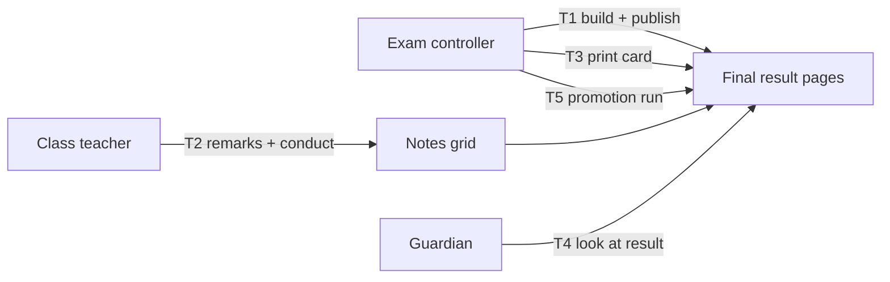

# Epic 70 usability test — final result

Epic 70 (#2203), ticket 70.0.01 (#3400). Words in [`epic-70-glossary.md`](epic-70-glossary.md). Mockups in [`epic-70-mockups/`](epic-70-mockups/): `.html`, `-1440.png`, `-390.png`.

**Status: pending human run.** Nothing below was tested. No result is filled in or guessed. Steps 4-5 of #3400 need three real people.

Known limit: mockups are still pictures, so "press" means the tester points and says what they would press. The facilitator shows the next picture.

## Participants

| #   | Who             | Must be true                      | Tasks      | Name / date |
| --- | --------------- | --------------------------------- | ---------- | ----------- |
| P1  | Exam controller | runs exams in a real school       | T1, T3, T5 | _blank_     |
| P2  | Class teacher   | has a class teacher section       | T2         | _blank_     |
| P3  | Guardian        | has a child in school, uses phone | T4         | _blank_     |

First names only in this file. No phone numbers, no photos, no real child names (the repo is public).

## Tasks and targets

Target for every task: done **unaided** (no hint from the facilitator) in **3 minutes or less**. Mockups stay fixed until all five pass.

| Task | Say this (bn, as read to tester)                                                  | Success =                                                            | Mockup(s)                                                  |
| ---- | --------------------------------------------------------------------------------- | -------------------------------------------------------------------- | ---------------------------------------------------------- |
| T1   | "ক্লাস ৮-এর চূড়ান্ত ফলাফল বানান: অর্ধবার্ষিক ৩০, বার্ষিক ৭০। তারপর প্রকাশ করুন।" | Picks both exams, types 30 and 70, builds, then publishes.           | `final-list`, `final-detail-setup`, `final-detail-results` |
| T2   | "৮-ক-র ছাত্রদের মন্তব্য আর আচরণ দিন।"                                             | Writes a remark and picks a conduct grade for a student, then saves. | `my-class-notes`                                           |
| T3   | "একজন ছাত্রের রিপোর্ট কার্ড ছাপুন।"                                               | Reaches the print tab and prints one student's card.                 | `final-report-card`                                        |
| T4   | "অভিভাবক হিসেবে সন্তানের ফল দেখুন।"                                               | Finds the চূড়ান্ত ফলাফল card first and reads the result aloud.      | `portal-final-result`                                      |
| T5   | "চূড়ান্ত ফল থেকে প্রমোশন রান শুরু করুন।"                                         | Finds the promotion start from the final result.                     | **none yet** (see gap below)                               |

Settings mockup `settings-conduct-items` is not a task screen on its own. Show it only if a tester asks where conduct items come from.

**Gap to settle before the run:** none of the seven mockups draws the promotion start (T5). Either add a mockup for it first, or run T5 as a spoken question and record it as "not tested on a picture". Do not count it as passed.

## Script (per task)

1. Say: this is a school app; the picture is page X. Say it once.
2. Read the task. Say nothing else. Start the timer when you stop talking.
3. Ask them to think aloud. Do not hint. If silent for 20 seconds, ask only: "What are you looking for?"
4. Stop at "done" with the right control, or at 3:00 (that is a **fail**).
5. Ask: "In your own words, what does that button do?" and "What happens next?"
6. Record time, unaided yes/no, where they hesitated, words they used.
7. Fix rule: more than 10 seconds on one control, or a word not in the glossary, counts as a finding even if the task passed.

## Results (fill in on the human run)

| Task | Person | Time (m:ss) | Unaided? (y/n) | Where they hesitated | Words used | Pass (3:00 or less, unaided) |
| ---- | ------ | ----------- | -------------- | -------------------- | ---------- | ---------------------------- |
| T1   | P1     |             |                |                      |            |                              |
| T2   | P2     |             |                |                      |            |                              |
| T3   | P1     |             |                |                      |            |                              |
| T4   | P3     |             |                |                      |            |                              |
| T5   | P1     |             |                |                      |            |                              |

## What changed after the test

| Round | Screen | What was unclear | Change | Re-test result |
| ----- | ------ | ---------------- | ------ | -------------- |
|       |        |                  |        |                |

Repeat rounds until every row above passes. Then re-shoot (`node .claude/skills/redesign-page/scripts/shoot.mjs`), re-upload with `upload.sh e70-<slug>`, and update the image links in the W5 tickets.

## Questions for the human run

- Does "কত শতাংশ গোনা হবে" read as "how much each exam counts" without help?
- Does "ফল তৈরি করুন" read as the step before "প্রকাশ করুন"?
- Does the guardian read the চূড়ান্ত ফলাফল card as the year's result, not one exam's?
