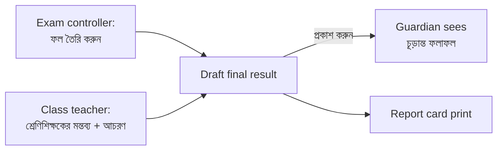

# Epic 70 glossary — final result

Plain words for every screen, message and error in Epic 70 (#2203). Use the **Say** columns in the app. Never use the **Never say** column on a screen, in a button, in an error or in a message a guardian reads.

## Words

| Say (bn)               | Say (en)                    | Never say                  | Where it shows                        |
| ---------------------- | --------------------------- | -------------------------- | ------------------------------------- |
| চূড়ান্ত ফলাফল         | Final result                | composition, annual result | page title, nav, list, portal card    |
| কত শতাংশ গোনা হবে      | Share (%)                   | weight                     | setup table column header, per exam   |
| ফল তৈরি করুন           | Build results               | process                    | button on setup tab                   |
| প্রকাশ করুন            | Publish                     | release, finalise          | button, publish dialog                |
| অনুপস্থিত              | Absent                      | null, missing              | results table cell, report card       |
| কর্মদিবস · উপস্থিত দিন | Working days · Days present | attendance                 | report card attendance line           |
| শ্রেণিশিক্ষকের মন্তব্য | Class teacher's remark      | note, comment              | notes grid column, report card        |
| আচরণ ও সহশিক্ষা        | Conduct and co-curricular   | evaluation                 | notes grid, settings list             |
| সেরা N পরীক্ষা গোনা    | Count best N exams          | best-of                    | mode choice on setup tab              |
| বিষয়ভেদে আলাদা ভাগ    | Different share by subject  | override                   | per-subject share switch on setup tab |

Conduct scale on screen: A best, D weakest (fixed, D30). Never say **weight, process, composition, null, best-of, override, evaluation**.

**Open:** a native Bangla reader has not checked these terms yet. That is part of the human run (see `epic-70-final-result.md`).

## Error and help sentences (always next to the control)

| Where                                     | bn                                                                   | en                                           |
| ----------------------------------------- | -------------------------------------------------------------------- | -------------------------------------------- |
| Shares do not add up (setup)              | মোট ১০০ হতে হবে (এখন ৯০)।                                            | Must total 100 (now 90).                     |
| Shares hint under the table               | সব মিলিয়ে ১০০% হতে হবে।                                             | Everything together must be 100%.            |
| Renaming a conduct item                   | নাম বদলালে আগে প্রকাশিত ফলাফলে পুরোনো নামই থাকবে।                    | Old name stays on results already published. |
| Conduct list limit                        | সর্বোচ্চ ৮টি বিষয়।                                                  | At most 8 items.                             |
| Conduct empty grade                       | খালি রাখলে কার্ডে দেখাবে না।                                         | Leave empty: not shown on the card.          |
| Publish dialog (D18, warns, never blocks) | N জনের শ্রেণিশিক্ষকের মন্তব্য নেই, M জনের আচরণ ও সহশিক্ষা গ্রেড নেই। | N students have no remark, M no conduct.     |

The exact build-refusal sentences (reopen blocked, exam missing) are fixed by the server tickets, not drawn on the mockups. Add them here when those tickets land.
