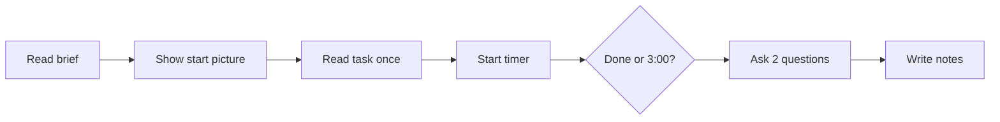

# Epic 70 observer sheet

For the facilitator. Print one copy per person. Fill it in **during** the session. Do not fill it in from memory later. Results go to the table in [`epic-70-final-result.md`](epic-70-final-result.md); this sheet is the raw notes.

**Rules for every task**

- Hints allowed: **none**. Only allowed words after 20 seconds of silence: "আপনি কী খুঁজছেন?"
- Timer starts when you stop reading the task. Stop at "done" with the right control, or at 3:00 (3:00 = fail).
- Mark a finding if one control takes more than 10 seconds, or the person uses a word not in [`epic-70-glossary.md`](epic-70-glossary.md).
- Pictures are fixed: the person says what they would press, you show the next picture.
- Do not write real names or phone numbers. Use P1, P2, P3.

**Session:** person ___ date ___ facilitator ___ picture size: desktop / phone

---

## T1 (P1 exam controller)

| | |
| --- | --- |
| Start picture | `final-list` (open it first) |
| Read aloud (bn) | "ক্লাস ৮-এর চূড়ান্ত ফলাফল বানান: অর্ধবার্ষিক ৩০, বার্ষিক ৭০। তারপর প্রকাশ করুন।" |
| Success | Picks both exams, types 30 and 70, builds, then publishes. |
| Hints allowed | none |
| Timer | start ___ stop ___ total ___ : ___ (limit 3:00) |

Observed (tick what happened):

- [ ] Opened the right class row
- [ ] Ticked both exams
- [ ] Typed 30 and 70
- [ ] Found Save
- [ ] Found ফল তৈরি করুন (build)
- [ ] Found প্রকাশ করুন (publish)
- [ ] Read the yellow banner as a warning, not a block
- [ ] Went the wrong way first (where: ______)
- [ ] Paused more than 10 seconds (on: ______)
- [ ] Used a word not in the glossary (word: ______)
- [ ] Needed a hint (do not give; mark it and stop the task = fail)

After the task ask: "নিজের ভাষায় বলুন, এই বোতাম কী করে?" and "এরপর কী হবে বলে মনে করেন?"

Answer 1: ______________________  Answer 2: ______________________

Quote (exact words, bn or en):

> 

Unaided: yes / no   Pass: yes / no

---

## T2 (P2 class teacher)

| | |
| --- | --- |
| Start picture | `my-class-notes` |
| Read aloud (bn) | "৮-ক-র ছাত্রদের মন্তব্য আর আচরণ দিন।" |
| Success | Writes a remark and picks a conduct grade for a student, then saves. |
| Hints allowed | none |
| Timer | start ___ stop ___ total ___ : ___ (limit 3:00) |

Observed (tick what happened):

- [ ] Wrote a remark
- [ ] Picked a conduct grade
- [ ] Understood A vs D without help
- [ ] Found Save
- [ ] Asked what happens to rows left empty
- [ ] Went the wrong way first (where: ______)
- [ ] Paused more than 10 seconds (on: ______)
- [ ] Used a word not in the glossary (word: ______)
- [ ] Needed a hint (do not give; mark it and stop the task = fail)

After the task ask: "নিজের ভাষায় বলুন, এই বোতাম কী করে?" and "এরপর কী হবে বলে মনে করেন?"

Answer 1: ______________________  Answer 2: ______________________

Quote (exact words, bn or en):

> 

Unaided: yes / no   Pass: yes / no

---

## T3 (P1 exam controller)

| | |
| --- | --- |
| Start picture | `final-detail-results` (then they must find the print tab) |
| Read aloud (bn) | "একজন ছাত্রের রিপোর্ট কার্ড ছাপুন।" |
| Success | Reaches the print tab and prints one student's card. |
| Hints allowed | none |
| Timer | start ___ stop ___ total ___ : ___ (limit 3:00) |

Observed (tick what happened):

- [ ] Found the ছাপা tab
- [ ] Chose a student
- [ ] Pressed শুধু এই কার্ড ছাপুন (not সব কার্ড)
- [ ] Said what নমুনা দেখুন does (wrong = note it)
- [ ] Went the wrong way first (where: ______)
- [ ] Paused more than 10 seconds (on: ______)
- [ ] Used a word not in the glossary (word: ______)
- [ ] Needed a hint (do not give; mark it and stop the task = fail)

After the task ask: "নিজের ভাষায় বলুন, এই বোতাম কী করে?" and "এরপর কী হবে বলে মনে করেন?"

Answer 1: ______________________  Answer 2: ______________________

Quote (exact words, bn or en):

> 

Unaided: yes / no   Pass: yes / no

---

## T4 (P3 guardian (phone-size picture `portal-final-result-390`))

| | |
| --- | --- |
| Start picture | `portal-final-result` |
| Read aloud (bn) | "অভিভাবক হিসেবে সন্তানের ফল দেখুন।" |
| Success | Finds the চূড়ান্ত ফলাফল card first and reads the result aloud. |
| Hints allowed | none |
| Timer | start ___ stop ___ total ___ : ___ (limit 3:00) |

Observed (tick what happened):

- [ ] Went to the top card first
- [ ] Read GPA or grade aloud
- [ ] Said it is the whole year, not one exam
- [ ] Mixed it up with an exam card (note which)
- [ ] Went the wrong way first (where: ______)
- [ ] Paused more than 10 seconds (on: ______)
- [ ] Used a word not in the glossary (word: ______)
- [ ] Needed a hint (do not give; mark it and stop the task = fail)

After the task ask: "নিজের ভাষায় বলুন, এই বোতাম কী করে?" and "এরপর কী হবে বলে মনে করেন?"

Answer 1: ______________________  Answer 2: ______________________

Quote (exact words, bn or en):

> 

Unaided: yes / no   Pass: yes / no

---

## T5 (P1 exam controller)

| | |
| --- | --- |
| Start picture | `final-detail-results` (the final result page) |
| Read aloud (bn) | "চূড়ান্ত ফল থেকে প্রমোশন রান শুরু করুন।" |
| Success | Finds the promotion start from the final result. |
| Hints allowed | none |
| Timer | start ___ stop ___ total ___ : ___ (limit 3:00) |

Observed (tick what happened):

- [ ] Looked for a button on the result page
- [ ] Said or pointed to sidebar প্রমোশন
- [ ] Opened the form (`promotion-start`)
- [ ] Saw চূড়ান্ত ফলাফল is already picked
- [ ] Pressed তালিকা তৈরি করুন
- [ ] Went the wrong way first (where: ______)
- [ ] Paused more than 10 seconds (on: ______)
- [ ] Used a word not in the glossary (word: ______)
- [ ] Needed a hint (do not give; mark it and stop the task = fail)

After the task ask: "নিজের ভাষায় বলুন, এই বোতাম কী করে?" and "এরপর কী হবে বলে মনে করেন?"

Answer 1: ______________________  Answer 2: ______________________

Quote (exact words, bn or en):

> 

Unaided: yes / no   Pass: yes / no

---

## After the session

1. Copy time, unaided, hesitation and words into the Results table in `epic-70-final-result.md`.
2. Put each finding in "What changed after the test" with the screen name.
3. Thank the person. No payment promises were made unless you agreed them yourself.
