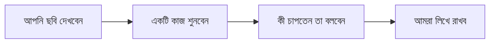

# আমরা কী করব (এক পাতা)

এটি অংশগ্রহণকারীর জন্য। সহজ ভাষায় লেখা।

## আজ কী হবে

- আমরা একটি নতুন স্কুল-অ্যাপের কয়েকটি **ছবি** দেখাব।
- প্রতিটি ছবিতে একটি ছোট কাজ দেব। যেমন: "সন্তানের ফল দেখুন।"
- আপনি বলবেন, ছবির কোথায় চাপতেন। আমরা পরের ছবি দেখাব।
- সব মিলিয়ে প্রায় ২০ থেকে ৩০ মিনিট লাগবে।

## মনে রাখবেন

- **আমরা পরীক্ষা করছি অ্যাপের পাতা, আপনাকে নয়।** ভুল হলে দোষ পাতার, আপনার নয়।
- **কোনো সঠিক বা ভুল উত্তর নেই।** আপনি যা ভাবেন, তা-ই আমাদের কাজে লাগবে।
- **মনে মনে যা ভাবছেন, জোরে বলুন।** যেমন: "আমি এই বোতামটা খুঁজছি" বা "এটা বুঝতে পারছি না।"
- কাজ আটকে গেলে আমরা সাহায্য করব না। এটা নিয়ম, কারণ আমরা দেখতে চাই পাতাটা নিজে নিজে বোঝা যায় কি না।
- যে কোনো সময় থামতে চাইলে বলুন। কোনো কারণ দিতে হবে না।

## আপনার তথ্য

- আমরা শুধু আপনার প্রথম নাম বা "অংশগ্রহণকারী ১" লিখব।
- ফোন নম্বর, ছবি বা আপনার সন্তানের নাম লিখব না।
- আপনার কথা বা পর্দার ছবি রেকর্ড করতে চাইলে আগে আপনাকে জিজ্ঞেস করব। না বললে রেকর্ড হবে না।
- ফলাফল অ্যাপ বানানোর কাজে ব্যবহার হবে। আপনার নাম কোথাও প্রকাশ হবে না।

## শুরুর আগে

আপনি কি রাজি? ছোট করে "হ্যাঁ" বললেই হবে।

- [ ] হ্যাঁ, আমি রাজি।
- [ ] রেকর্ডিংয়ে রাজি (ঐচ্ছিক)।

*(সুবিধাদাতা: রাজি হওয়ার কথা অংশগ্রহণকারী মুখে বললে এখানে টিক দিন।)*
